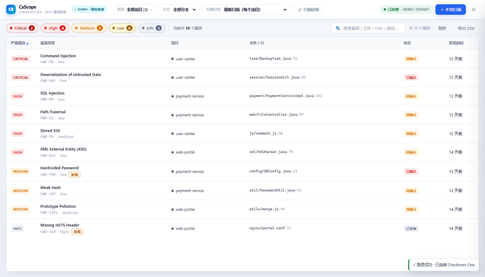
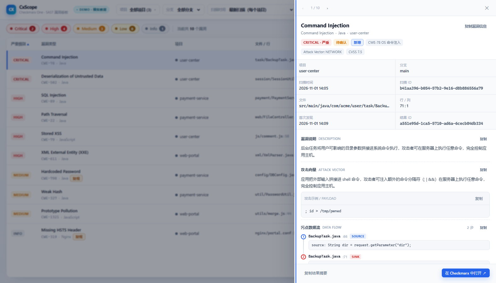
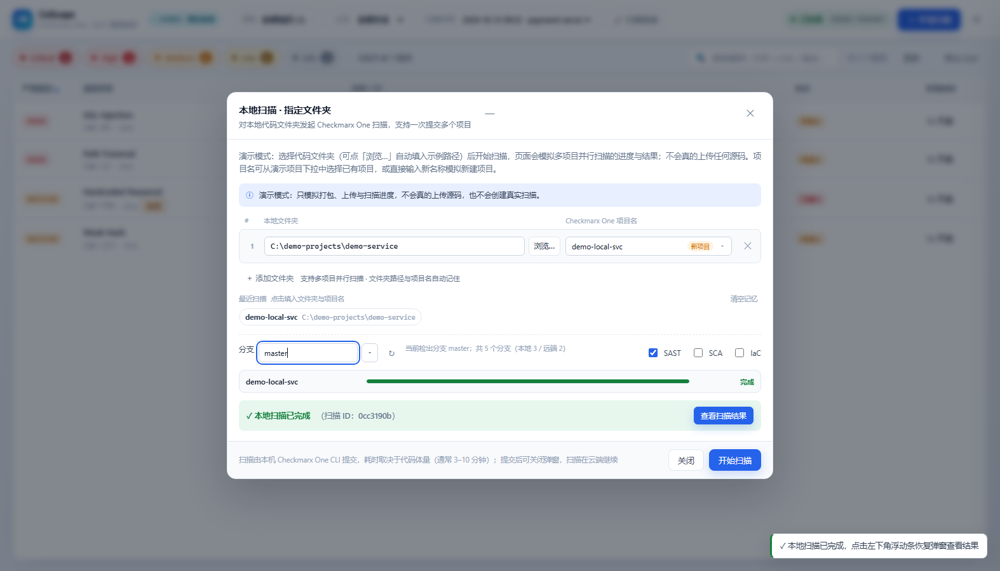

# CxScope · Checkmarx One 漏洞看板

[English](README_EN.md) | **简体中文**

> 一个跑在本机的 Checkmarx One SAST 看板：用 API Key 登录，在一屏里完成项目 / 分支 / 扫描筛选、漏洞审阅与一键复制，并能直接调用本机 Checkmarx One CLI 扫描本地代码。



## 为什么做这个项目

Checkmarx One 自带控制台适合「按项目逐层点开」，但日常安全评审真正耗时的，往往是点开之后的整理工作：

| 痛点 | 原生体验 | CxScope 的做法 |
| --- | --- | --- |
| 跨项目 / 分支对比 | 逐个项目、逐次扫描点进去，筛选条件来回重置 | 项目多选 + 分支 + 扫描时间 + 严重级别联动筛选，一屏看完 |
| 漏洞上下文分散 | 描述、攻击向量、数据流、修复建议、参考链接散落在不同页面 | 右侧详情抽屉聚合展示，按块阅读 |
| 粘贴到工单 / IM | 网页框选复制格式错位，还容易混入特殊空白字符 | 每个区块独立「复制」，输出纯文本，空格 / 换行统一 |
| 本地代码临时扫一次 | 记 CLI 参数、手动建项目、盯进度 | 页面里选文件夹、自动读 Git 分支、调用本机 CLI 并轮询进度 |
| 浏览器直连 API | Checkmarx IAM / REST 不允许跨域 | 本机 `proxy.py` 转发，Key 不出本机 |
| 多租户 / 多环境 | 筛选记忆容易串数据 | 记忆按「租户 + API 地址」隔离 |

## 它能做什么

- **API Key 登录**：粘贴 Checkmarx One API Key 即可，JWT 的 `aud` 自动解析 IAM realm / 租户，`ast-base-url` 作为 API 地址，无需手选区域。
- **项目多选**：默认不选项目；下拉内可按名称实时搜索（多关键词、命中高亮），勾选过程中不查询，点「应用」后统一加载。
- **分支 / 扫描时间联动**：「最新扫描（每个项目）」或指定某一次扫描；切换项目或分支会刷新可选的扫描时间。
- **严重级别筛选**：Critical / High / Medium / Low / Info 点击即筛选，实时计数；选择结果自动记住。
- **搜索 / 排序 / 导出**：按漏洞类型、文件、CWE、描述全文搜索；表格排序；导出当前筛选结果为 CSV。
- **详情抽屉**：漏洞说明、攻击向量（内置知识库 + CVSS）、污点数据流（source → propagator → sink）、修复建议（含错误 / 修复代码示例）、参考链接（CWE / OWASP / Checkmarx）。
- **一键复制**：漏洞名称一行右侧可复制完整 9 项信息；各区块也可单独复制。复制前统一把不间断空格、全角空格、零宽字符等转换为标准空格，Tab 转 4 空格，换行统一为 `\n`，粘贴到 IM / 工单 / AI 对话不会格式错位。
- **扫描链接直达**：粘贴浏览器里的 Checkmarx One 扫描结果链接（或扫描 ID）直接定位。
- **本地扫描**：选择本地文件夹（可多个）→ 本机代理调用 Checkmarx One CLI（`cx scan create --async`）上传源码并创建扫描 → 页面轮询进度 → 完成后自动切到结果。项目名可从已有项目下拉选择，也可输入新名称；分支从文件夹的 Git 仓库自动读取；扫描可最小化为左下角进度条。
- **本机记忆**：API Key（可选）、项目 / 分支 / 严重级别选择、本地扫描的文件夹与项目名都保存在浏览器 localStorage，并按租户 + API 地址隔离。



## 架构

```text
浏览器（index.html）
   │  /proxy  /local-scan  /git-branches  /pick-folder
   ▼
proxy.py（默认 127.0.0.1:8787，仅 Python 标准库）
   ├─► Checkmarx One REST API   读取项目 / 扫描 / 结果，轮询扫描状态
   └─► 本机 Checkmarx One CLI   打包 + 上传 + 创建扫描（--async）
```

- 页面是纯静态 HTML / CSS / JS，由 `proxy.py` 直接提供；
- 浏览器不直接访问 Checkmarx：IAM 与 REST 都不允许跨域，统一走本机代理；
- 代理只监听本机，并且只允许转发到 `*.checkmarx.net` / `*.checkmarx.com`（或 `EXTRA_HOST` 显式追加的域名），不是开放代理；
- 本地扫描的源码打包与上传由官方 CLI 完成，代理只负责调用 CLI、解析扫描 ID。

## 快速开始

### 前置条件

| 依赖 | 是否必需 | 说明 |
| --- | --- | --- |
| Python 3.9+ | 必需 | 仅使用标准库，无需 `pip install` |
| Checkmarx One 账号 + API Key | 必需 | Checkmarx One → 右上角设置 → API Keys → 生成 |
| Checkmarx One CLI（`cx` / `cx.exe`） | 本地扫描时需要 | 需支持 `cx scan create --async`；放在 PATH 或用 `CX_CLI_PATH` 指定 |
| Git | 可选 | 本地扫描时自动读取分支；未安装则回退为手动输入 |
| tkinter | 可选 | 「浏览…」文件夹选择框；缺失时可手动输入路径 |

### 启动

```powershell
# 1. 启动本机代理（默认 http://127.0.0.1:8787/）
python proxy.py

# 2. 浏览器打开
#    http://127.0.0.1:8787/

# 3. 粘贴 Checkmarx One API Key 登录
#    与 IDEA 插件使用的是同一个 API Key
```

启动日志会打印本地扫描方式与 CLI 路径；找不到 CLI 时看板浏览不受影响，只有「本地扫描」会失败并显示原因。

### 先看效果（离线 Demo）

不想配置 API Key？直接双击打开 `demo/current-page-demo.html`：

- 模拟登录（已预填 `DEMO-API-KEY`），内置 mock 数据；
- 与正式页面同一套代码，完整交互可点；
- 不发起任何网络请求，不需要 `proxy.py`。



## 本地扫描是怎么工作的

1. 页面通过本机代理 `/git-branches` 只读读取所选文件夹的 Git 分支（不修改、不 fetch）；
2. 浏览器把文件夹路径、项目名、分支、扫描类型，以及登录得到的 API Key / API 地址 / IAM 地址发给 `/local-scan`；
3. 代理为每个文件夹执行：

   ```powershell
   cx scan create --project-name <项目名> --branch <分支> -s <文件夹> `
     --scan-types sast --exclude-git-folder --async --scan-info-format json `
     --base-uri <API 地址> --base-auth-uri <IAM 地址> --tenant <租户>
   ```

   - API Key 通过环境变量 `CX_APIKEY` 传给 CLI 子进程，不出现在命令行参数里；
   - 扫描类型勾选映射为 `--scan-types`：SAST → `sast`，SCA → `sca`，IaC → `iac-security`；
   - 默认 `--exclude-git-folder`，不会把 `.git` 打进上传包；
   - 其他参数可用 `CX_CLI_EXTRA_ARGS` 透传（如企业代理）。

4. 页面轮询 `GET /api/scans/{id}`，完成后刷新项目与结果，并自动切到本次扫描的项目。

> 本地扫描仍然是**上传源码到 Checkmarx One 云端扫描**（由 CLI 打包上传），不是纯离线静态分析。
> 旧版「代理自行 REST 上传」保留为兼容回退：设置 `SCAN_MODE=api` 即可。

## 配置项

| 变量 | 默认值 | 说明 |
| --- | --- | --- |
| `PORT` | `8787` | 代理监听端口 |
| `BIND_HOST` | `127.0.0.1` | 监听地址（建议保持本机） |
| `EXTRA_HOST` / `ALLOWED_HOSTS` | 空 | 追加允许转发的域名（单租户 / 自建域名必需） |
| `INSECURE` | `0` | `1` 时忽略自签证书（内网 https）；CLI 模式追加 `--insecure` |
| `SCAN_MODE` | `cli` | 本地扫描方式：`cli` = 调用本机 CLI（推荐）；`api` = 旧 REST 上传（兼容回退） |
| `CX_CLI_PATH` | 空 | Checkmarx One CLI 路径；为空时在 PATH 中查找 |
| `CX_CLI_TIMEOUT` | `900` | 单次 CLI 调用超时秒数（打包 + 上传 + 创建扫描） |
| `CX_SAST_PRESET` | 空 | 可选：SAST 预设名；为空用租户默认预设 |
| `CX_CLI_EXTRA_ARGS` | 空 | 可选：附加 CLI 参数（空格分隔），如 `--proxy http://corp-proxy:8080 --ignore-proxy` |
| `MAX_UPLOAD_MB` | `200` | 单文件夹压缩后大小上限（仅 `SCAN_MODE=api` 生效） |
| `UPSTREAM_TIMEOUT` | `180` | 上游请求超时秒数 |

示例：

```powershell
# 单租户 / 自建域名 + 自签证书
$env:EXTRA_HOST="checkmarx.company.com"; $env:INSECURE="1"; python proxy.py

# 指定 Checkmarx One CLI + 团队统一 SAST 预设
$env:CX_CLI_PATH="C:\tools\cx\cx.exe"; $env:CX_SAST_PRESET="Company-Recommended"; python proxy.py

# 企业网络经代理访问（参数透传给 CLI）
$env:CX_CLI_EXTRA_ARGS="--proxy http://corp-proxy:8080"; python proxy.py
```

## 安全说明

- 代理只监听 `127.0.0.1`，且只转发白名单域名，不是开放代理；
- API Key 只存在浏览器 localStorage、本机内存与 CLI 子进程环境变量中，不经过第三方服务器；
- 「记住 API Key」默认由用户勾选；共用电脑上建议不勾选，怀疑泄露时在 Checkmarx One 中吊销；
- 本地扫描弹窗中的文件夹路径与项目名同样只保存在本机浏览器，可按租户清除；
- 仓库中的截图与 Demo 均使用 mock 数据（`DEMO-TENANT` / `acme`），不包含真实租户信息。

## 目录结构

```text
index.html              构建产物：正式页面（由 proxy.py 直接提供）
proxy.py                本地代理：页面服务 + API 转发 + 本地扫描 + Git 分支读取
app/
  index.template.html   页面骨架
  app.js                应用逻辑（登录、筛选、详情、复制、本地扫描）
  kb.js                 内置漏洞知识库（攻击向量 / 修复示例 / CWE 参考）
  demo-mock.js          离线 Demo 的 mock API 层
  build.py              构建脚本：生成 index.html + demo/current-page-demo.html
demo/
  index.html            演示入口
  current-page-demo.html  当前页面的离线 Demo（推荐）
  demo-1/2/3*.html      早期布局原型
  _build/               Demo 构建脚本与模板
  shots/                Demo 截图
tests/
  mock_cxone.py         本地 Mock Checkmarx One（IAM + API + 扫描进度）
  fake_cx_cli.py        测试用假 CLI（校验代理传参）
  e2e.mjs               真实页面端到端测试（无头 Chrome）
  demo-page.mjs         离线 Demo 端到端测试（校验零网络请求）
```

## 开发与测试

```powershell
# 修改 app/ 下源码后重新生成 index.html + Demo
python app/build.py

# 真实页面端到端测试：自动启动 mock Checkmarx One + proxy.py + 无头 Chrome
node tests/e2e.mjs

# 离线 Demo 测试：file:// 打开，验证交互 + 零网络请求
node tests/demo-page.mjs
```

要求 Node.js 18+ 与本机安装 Chrome / Edge；测试不依赖真实 Checkmarx 租户。

## 已知限制

- 本地扫描默认通过本机 Checkmarx One CLI 执行，使用前需安装 CLI（或设置 `CX_CLI_PATH`）；
- CLI 方式按**项目名**匹配项目（CLI 没有 projectId 参数），项目改名后按新名称匹配；
- 内置知识库覆盖常见 CWE（SQL 注入、XSS、命令注入、SSRF、XXE、反序列化等 16 类），未命中类型显示通用说明；
- 攻击向量与修复示例属于通用安全建议，实际修复请以 Checkmarx 结果与业务代码为准；
- 「在 Checkmarx 中打开」按云版租户域名 `https://<tenant>.checkmarx.net` 拼接，单租户 / 自建环境的路由可能不同。

## 许可证

本仓库暂未附带开源许可证（默认保留所有权利）。如需开源，请自行添加 MIT / Apache-2.0 等许可证文件。