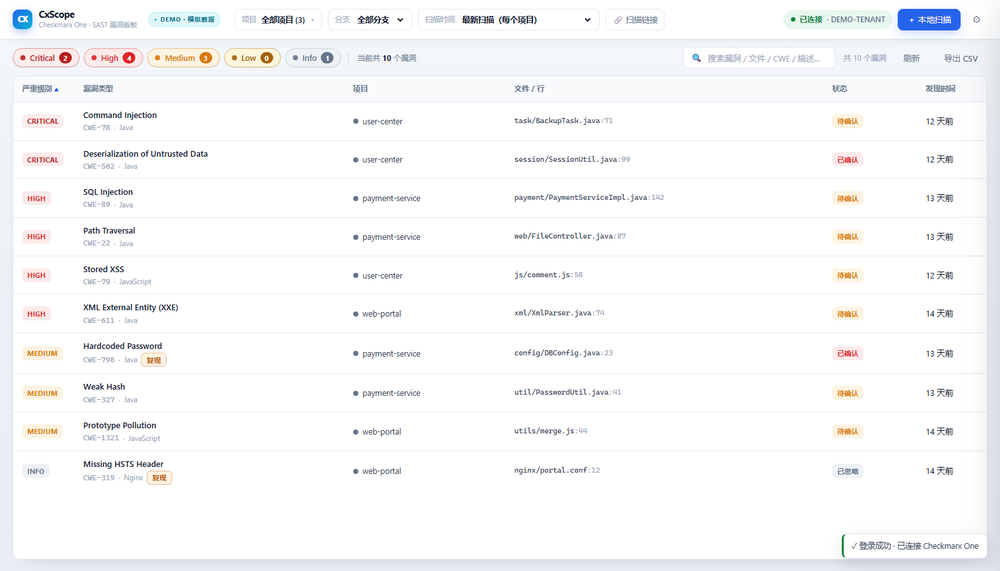
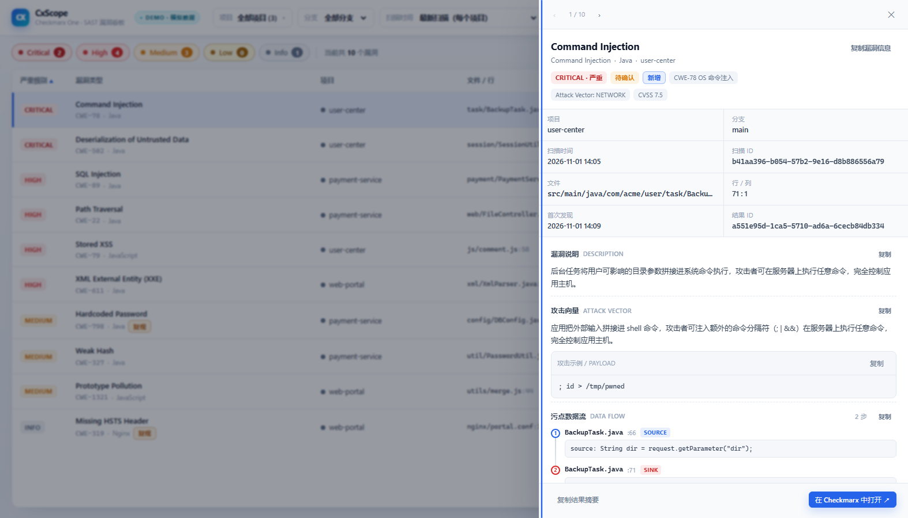
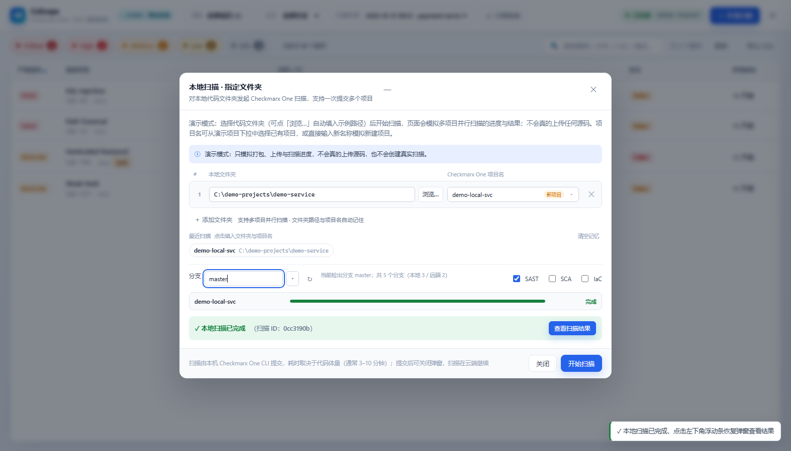

# CxScope · Checkmarx One Findings Dashboard

**English** | [简体中文](README.md)

> A local-first dashboard for Checkmarx One SAST results. Sign in with an API Key, filter by project / branch / scan and severity on one screen, review findings with attack vectors, data flows and remediation, copy them in one click, and trigger local scans through the Checkmarx One CLI.



## Why this project

The Checkmarx One console is built for drilling into one project at a time. The slow part of a security review usually starts after that:

| Pain point | Native experience | What CxScope does |
| --- | --- | --- |
| Comparing projects / branches | Open projects and scans one by one; filters reset constantly | Multi-project, branch, scan-time and severity filters on one screen |
| Scattered context | Description, attack vector, data flow, remediation and references live on different pages | One detail drawer that groups every section |
| Pasting into tickets / chat | Selecting text on the page breaks formatting and picks up odd whitespace | Per-section copy buttons that emit clean plain text |
| A quick scan of local code | Remember CLI flags, create projects manually, watch progress | Pick a folder, auto-detect Git branches, run the local CLI, poll progress |
| Browser access to the API | Checkmarx IAM / REST do not allow cross-origin calls | A local `proxy.py` forwards requests; the Key never leaves the machine |
| Multiple tenants / environments | Saved filters can leak across environments | State is isolated by tenant + API base URL |

## Features

- **API Key sign-in**: paste a Checkmarx One API Key; the JWT `aud` claim resolves the IAM realm / tenant and `ast-base-url` provides the API base URL. No region picker.
- **Multi-project filter**: nothing selected by default; search projects by name (multi-keyword, highlighted matches), apply once, then load.
- **Branch / scan-time filters**: latest scan per project or one specific scan; options refresh when the project or branch changes.
- **Severity chips**: Critical / High / Medium / Low / Info with live counts; selections are remembered.
- **Search / sort / CSV export** across type, file, CWE and description.
- **Detail drawer**: description, attack vector (built-in knowledge base + CVSS), data flow (source → propagator → sink), remediation (with vulnerable / fixed code samples) and references (CWE / OWASP / Checkmarx).
- **One-click copy**: copy all nine fields from the finding title, or copy each section separately. Text is normalized before copying — non-breaking spaces, full-width spaces and zero-width characters become standard spaces, tabs become four spaces, line endings become `\n` — so pasting into chat, tickets or an AI assistant keeps its shape.
- **Deep links**: paste a Checkmarx One scan URL (or a scan ID) to jump straight to that scan.
- **Local scans**: pick one or more local folders → the proxy invokes the Checkmarx One CLI (`cx scan create --async`) to package, upload and create the scan → the page polls progress and switches to the results. Project names can be picked from existing projects or typed as new; branches are read from the folder's Git repository; running scans can be minimized to a progress bar.
- **Local memory**: API Key (opt-in), filters and local-scan folder / project names are stored in browser localStorage, isolated per tenant + API base URL.



## Architecture

```text
Browser (index.html)
   │  /proxy  /local-scan  /git-branches  /pick-folder
   ▼
proxy.py (127.0.0.1:8787, Python standard library only)
   ├─► Checkmarx One REST API   projects / scans / results, scan polling
   └─► Checkmarx One CLI        package + upload + create scan (--async)
```

- The UI is plain HTML / CSS / JS served by `proxy.py`;
- The browser never calls Checkmarx directly: IAM and REST both reject cross-origin requests, so everything goes through the local proxy;
- The proxy binds to localhost only and forwards only to `*.checkmarx.net` / `*.checkmarx.com` (plus hosts added via `EXTRA_HOST`), so it is not an open proxy;
- Local scan packaging and upload are handled by the official CLI; the proxy only invokes it and parses the scan ID.

## Quick start

### Prerequisites

| Dependency | Required | Notes |
| --- | --- | --- |
| Python 3.9+ | Yes | Standard library only; no `pip install` needed |
| Checkmarx One account + API Key | Yes | Checkmarx One → Settings → API Keys → Create |
| Checkmarx One CLI (`cx` / `cx.exe`) | For local scans | Must support `cx scan create --async`; put it on PATH or set `CX_CLI_PATH` |
| Git | Optional | Used to auto-detect branches; falls back to manual input |
| tkinter | Optional | Native folder picker for the "Browse…" button |

### Run

```powershell
# 1. Start the local proxy (http://127.0.0.1:8787/)
python proxy.py

# 2. Open the page
#    http://127.0.0.1:8787/

# 3. Paste a Checkmarx One API Key and sign in
#    The same API Key used by the Checkmarx IDE plugin works here
```

The startup log prints the scan mode and the CLI path. If the CLI is missing, browsing still works; only local scans fail with an explicit error in the dialog.

### Try the offline demo

No API Key needed — open `demo/current-page-demo.html` directly:

- Mock sign-in (pre-filled `DEMO-API-KEY`) with built-in mock data;
- Same code as the production page, fully interactive;
- No network requests, no `proxy.py` required.



## How local scans work

1. The page asks the proxy (`/git-branches`) to read Git branches from the selected folder (read-only, no fetch);
2. The browser sends folder paths, project names, branch, scan types, API Key and API / IAM addresses to `/local-scan`;
3. For each folder the proxy runs:

   ```powershell
   cx scan create --project-name <name> --branch <branch> -s <folder> `
     --scan-types sast --exclude-git-folder --async --scan-info-format json `
     --base-uri <api-url> --base-auth-uri <iam-url> --tenant <tenant>
   ```

   - The API Key is passed through the `CX_APIKEY` environment variable, never as a command-line argument;
   - Scan types map to `--scan-types`: SAST → `sast`, SCA → `sca`, IaC → `iac-security`;
   - `--exclude-git-folder` keeps `.git` out of the upload by default;
   - Extra flags can be passed via `CX_CLI_EXTRA_ARGS` (for example a corporate proxy).

4. The page polls `GET /api/scans/{id}`, then refreshes projects and results when the scan completes.

> Local scans still **upload source code to Checkmarx One** and run in the cloud (the CLI packages and uploads it). This is not a fully offline analyzer.
> The legacy "proxy uploads via REST" path remains available as a fallback with `SCAN_MODE=api`.

## Configuration

| Variable | Default | Description |
| --- | --- | --- |
| `PORT` | `8787` | Proxy port |
| `BIND_HOST` | `127.0.0.1` | Bind address (keep it on localhost) |
| `EXTRA_HOST` / `ALLOWED_HOSTS` | empty | Extra hosts the proxy may forward to (required for single-tenant / self-hosted domains) |
| `INSECURE` | `0` | `1` ignores self-signed certificates (internal https); adds `--insecure` in CLI mode |
| `SCAN_MODE` | `cli` | `cli` = use the local CLI (recommended); `api` = legacy REST upload |
| `CX_CLI_PATH` | empty | Path to the Checkmarx One CLI; looked up on PATH when empty |
| `CX_CLI_TIMEOUT` | `900` | Timeout in seconds for one CLI invocation (package + upload + create scan) |
| `CX_SAST_PRESET` | empty | Optional SAST preset name; tenant default when empty |
| `CX_CLI_EXTRA_ARGS` | empty | Extra CLI flags (space-separated), e.g. `--proxy http://corp-proxy:8080 --ignore-proxy` |
| `MAX_UPLOAD_MB` | `200` | Max compressed folder size (only used with `SCAN_MODE=api`) |
| `UPSTREAM_TIMEOUT` | `180` | Upstream request timeout in seconds |

Examples:

```powershell
# Self-hosted domain with a self-signed certificate
$env:EXTRA_HOST="checkmarx.company.com"; $env:INSECURE="1"; python proxy.py

# Custom CLI path and a shared SAST preset
$env:CX_CLI_PATH="C:\tools\cx\cx.exe"; $env:CX_SAST_PRESET="Company-Recommended"; python proxy.py

# Corporate proxy (passed through to the CLI)
$env:CX_CLI_EXTRA_ARGS="--proxy http://corp-proxy:8080"; python proxy.py
```

## Security notes

- The proxy binds to `127.0.0.1` and only forwards to allow-listed hosts; it is not an open proxy;
- The API Key lives only in browser localStorage, process memory and the CLI child process environment — never on a third-party server;
- "Remember API Key" is opt-in; avoid it on shared machines, and revoke the Key in Checkmarx One if it may have leaked;
- Folder paths and project names from the local-scan dialog are stored in the browser only and can be cleared per tenant;
- All screenshots and demo data in this repository are mock data (`DEMO-TENANT` / `acme`); no real tenant information is included.

## Project layout

```text
index.html              Built page served by proxy.py
proxy.py                Local proxy: page serving + API forwarding + local scans + Git branches
app/
  index.template.html   Page skeleton
  app.js                Application logic (auth, filters, drawer, copy, local scans)
  kb.js                 Built-in vulnerability knowledge base
  demo-mock.js          Mock API layer for the offline demo
  build.py              Build script: index.html + demo/current-page-demo.html
demo/
  index.html            Demo entry page
  current-page-demo.html  Offline demo of the current UI (recommended)
  demo-1/2/3*.html      Earlier layout prototypes
  _build/               Demo build scripts and templates
  shots/                Demo screenshots
tests/
  mock_cxone.py         Mock Checkmarx One (IAM + API + scan progress)
  fake_cx_cli.py        Fake CLI used to verify proxy arguments
  e2e.mjs               End-to-end test of the real page (headless Chrome)
  demo-page.mjs         End-to-end test of the offline demo (zero network requests)
```

## Development and tests

```powershell
# Rebuild index.html + the demo after changing app/
python app/build.py

# End-to-end test: starts mock Checkmarx One + proxy.py + headless Chrome
node tests/e2e.mjs

# Offline demo test: opens file://, checks interactions and zero network requests
node tests/demo-page.mjs
```

Requires Node.js 18+ and a local Chrome / Edge installation. Tests do not need a real Checkmarx tenant.

## Known limitations

- Local scans use the Checkmarx One CLI, so the CLI must be installed (or `CX_CLI_PATH` set);
- CLI mode matches projects **by name** (the CLI has no projectId flag); renamed projects are matched by their new name;
- The built-in knowledge base covers 16 common CWE classes (SQL injection, XSS, command injection, SSRF, XXE, deserialization, etc.); unknown types fall back to generic guidance;
- Attack vectors and fix samples are general security advice — always confirm against the actual Checkmarx result and code;
- "Open in Checkmarx" builds `https://<tenant>.checkmarx.net` URLs, which may differ for single-tenant / self-hosted deployments.

## License

No open-source license is included yet, so all rights are reserved by default. Add MIT / Apache-2.0 if you intend to open-source it.